<div align="center">
  

  # Backup Hub

  **Self-hostable, scheduled backups for MySQL and PostgreSQL — with a web UI, a REST API, and encryption at rest.**

  [](code/LICENSE)
  
  
  
</div>

<p align="center">
  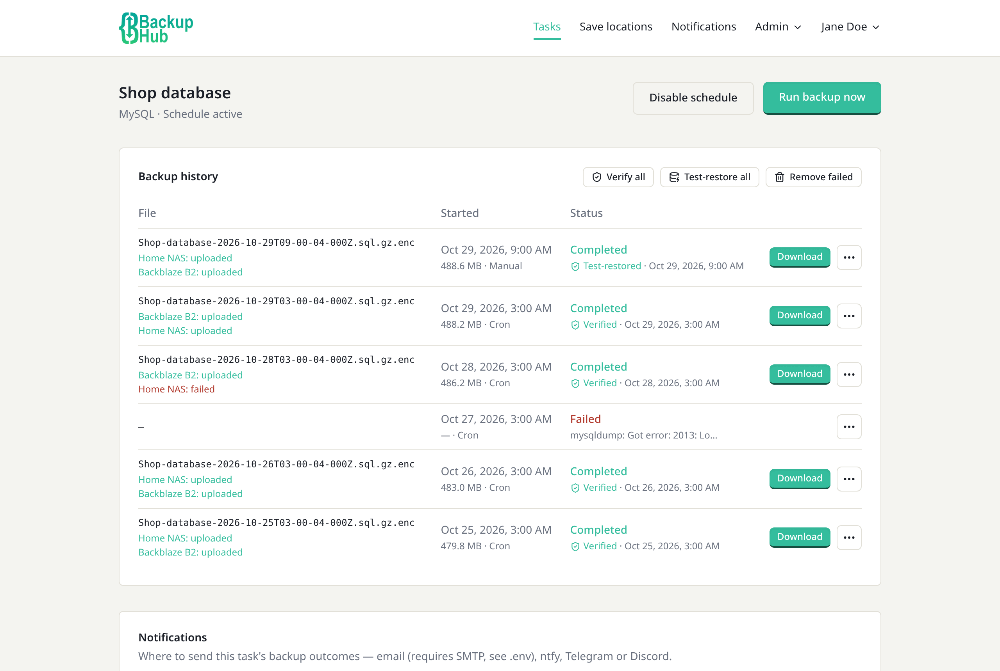
</p>

---

## What is this?

Backup Hub is a small, self-hostable service that takes scheduled, encrypted backups of your MySQL and PostgreSQL databases, and gives you a web UI and a REST API to manage them.

Point it at a database, give it a cron schedule and a retention count, and it handles the rest: running `mysqldump`/`pg_dump` on schedule, compressing and optionally encrypting the result, pruning old backups, copying them off-site, notifying you if a run fails, and letting you download — or restore — any backup from the browser.

A few highlights (the full list, with all the detail, is in [`code/README.md`](code/README.md)):

- Multi-user accounts with two roles (`admin` / `user`), TOTP + passkey two-factor auth, and per-task sharing
- One-click **restore**, and a **dry run** button to test a backup before you save the task
- **Backup checks**: every backup is read back and fingerprinted automatically, and can be **test-restored** into a throwaway database on a scratch server, so you know it actually restores
- **Off-site copies** to S3-compatible storage (AWS, Backblaze B2, Wasabi, R2, MinIO…), Google Drive, OneDrive, OpenCloud, FTP/FTPS, SFTP or email — set a location up once and reuse it across tasks
- **Notifications** by email, ntfy, Telegram or Discord, per task and system-wide
- A scoped REST API (`tasks:read`, `tasks:write`, `runs:trigger`, `runs:download`, `runs:delete`) for driving Backup Hub from other tools
- Everything encrypted at rest — stored DB credentials, save-location and notification credentials, backup passwords, and (optionally) the backup files themselves
- Works on your phone as well as your desktop

## Screenshots

**Your backup tasks** — each with its own database, schedule and retention.

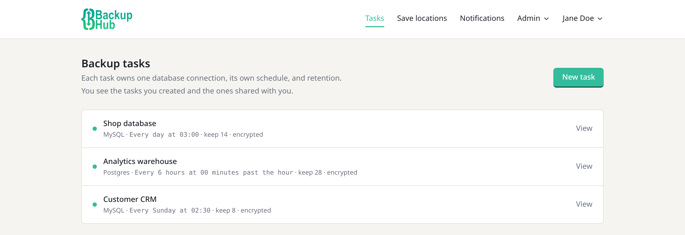

**Every backup's actions in one place** — download, restore, verify the file, test-restore it, or delete it. Check results show under each backup's status.

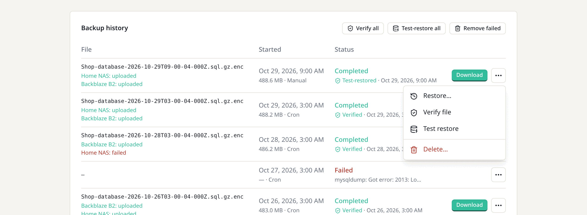

<table>
  <tr>
    <td width="50%" valign="top">
      <b>Save locations</b> — enter credentials once and reuse them on any task, or keep them task-only.<br /><br />
      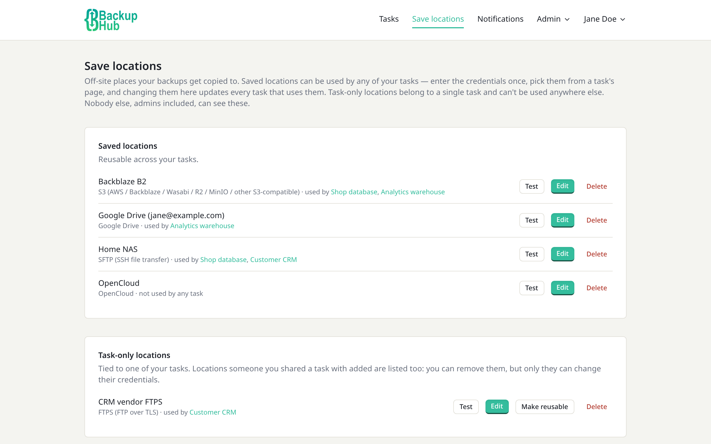
    </td>
    <td width="50%" valign="top">
      <b>Notifications</b> — email, ntfy, Telegram or Discord, chosen per task.<br /><br />
      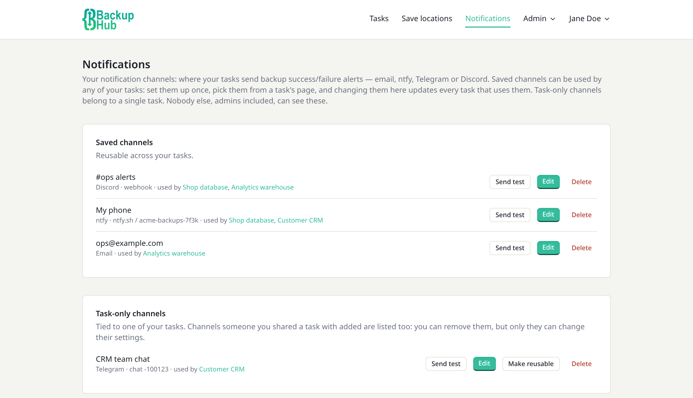
    </td>
  </tr>
</table>

**On your phone** — backup history, every backup's actions in a bottom drawer, and the navigation menu.

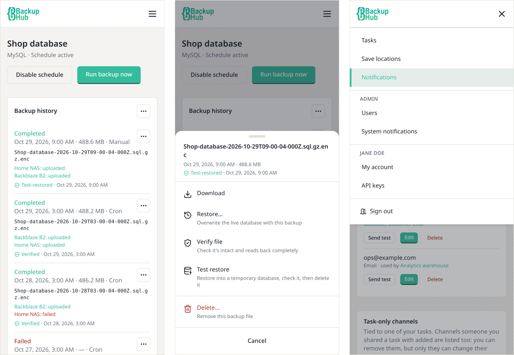

<details>
<summary><b>More screenshots</b> — task details, new task, account, users, API keys and sign-in</summary>
<br />

<table>
  <tr>
    <td width="50%" valign="top">
      <b>Task notifications</b> — pick saved channels or add one just for this task, and choose success and/or failure.<br /><br />
      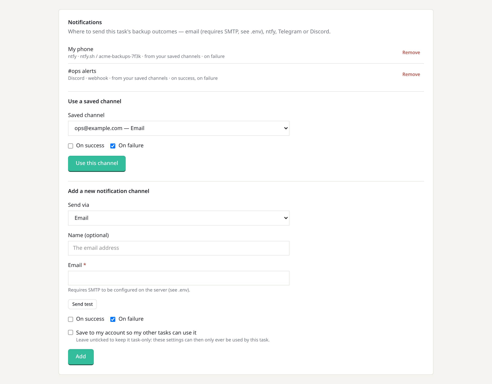
    </td>
    <td width="50%" valign="top">
      <b>Task save locations</b> — attach saved locations (each with its own subfolder) or add a task-only one.<br /><br />
      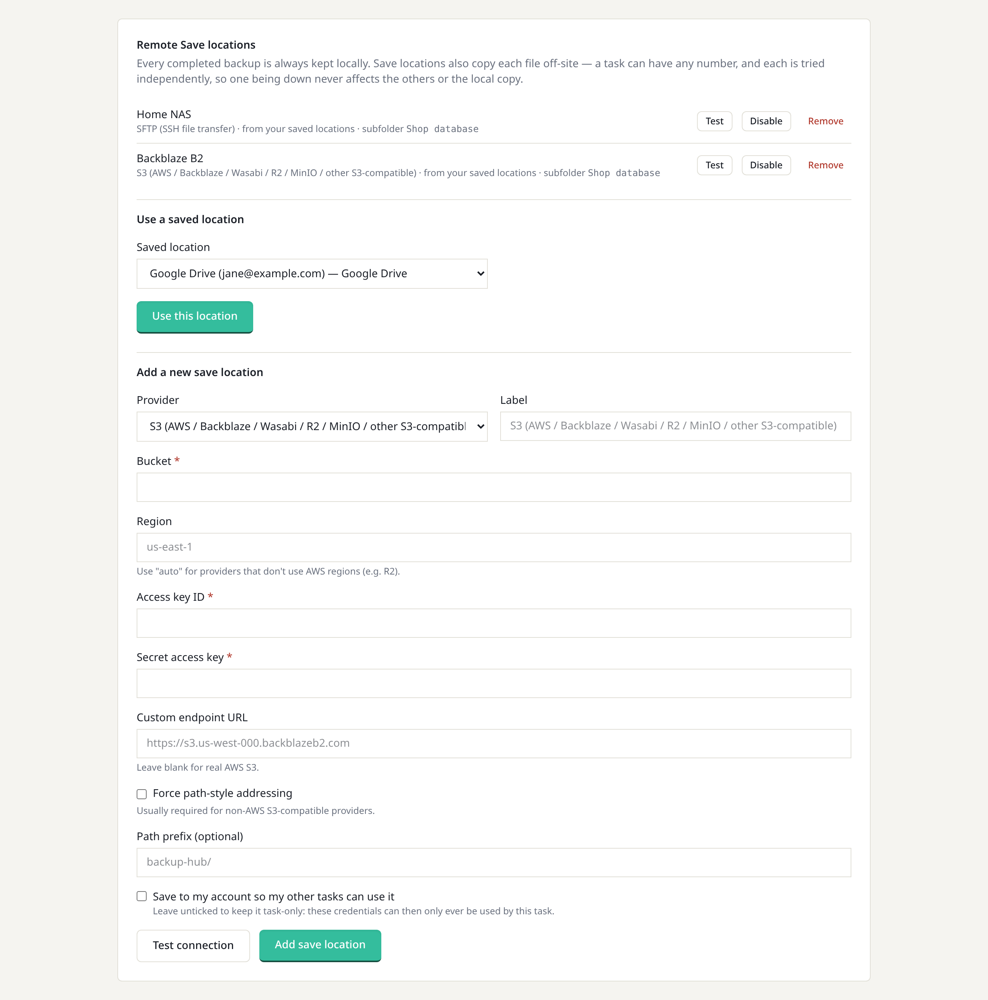
    </td>
  </tr>
</table>

<table>
  <tr>
    <td width="50%" valign="top">
      <b>Sharing and settings</b> — share a task with chosen permissions, and set its schedule, retention, encryption and test restores.<br /><br />
      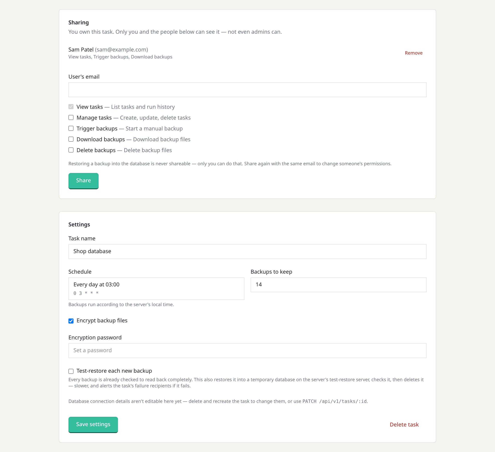
    </td>
    <td width="50%" valign="top">
      <b>New task</b> — connection details, a test-connection and dry-run button, schedule and encryption.<br /><br />
      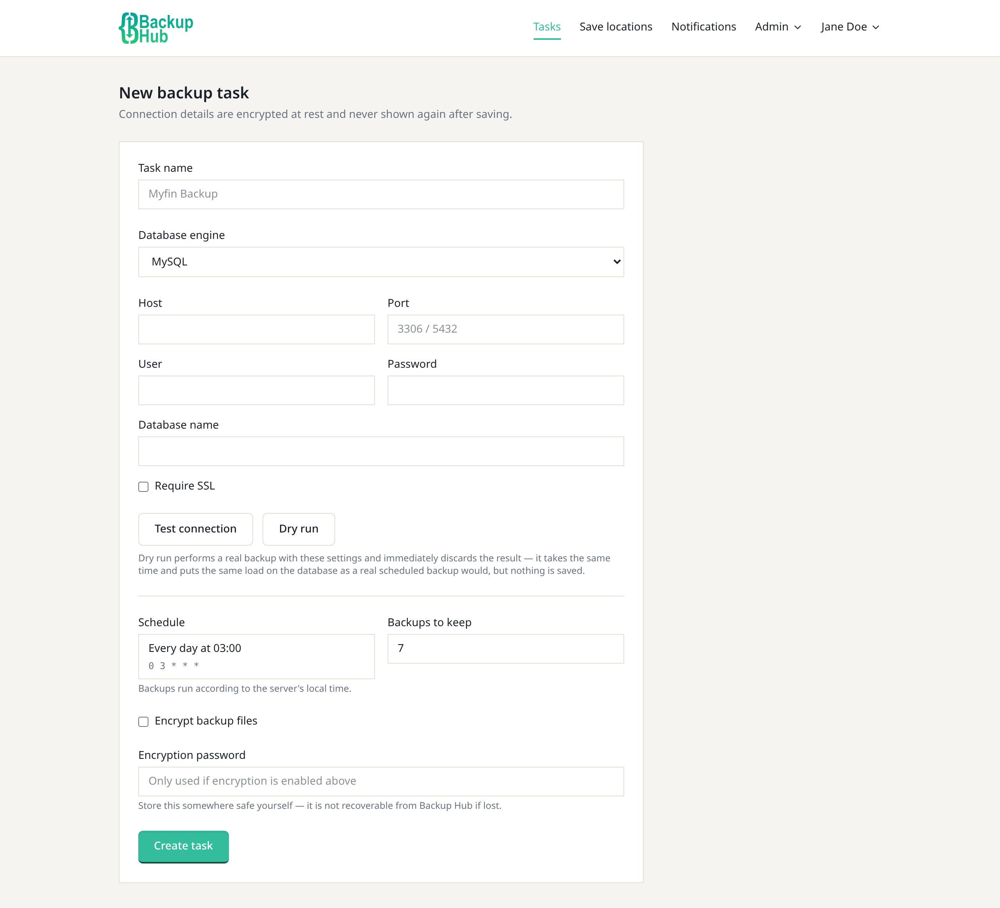
    </td>
  </tr>
</table>

<table>
  <tr>
    <td width="50%" valign="top">
      <b>Your account</b> — name and password, two-factor authentication with recovery codes, and passkeys.<br /><br />
      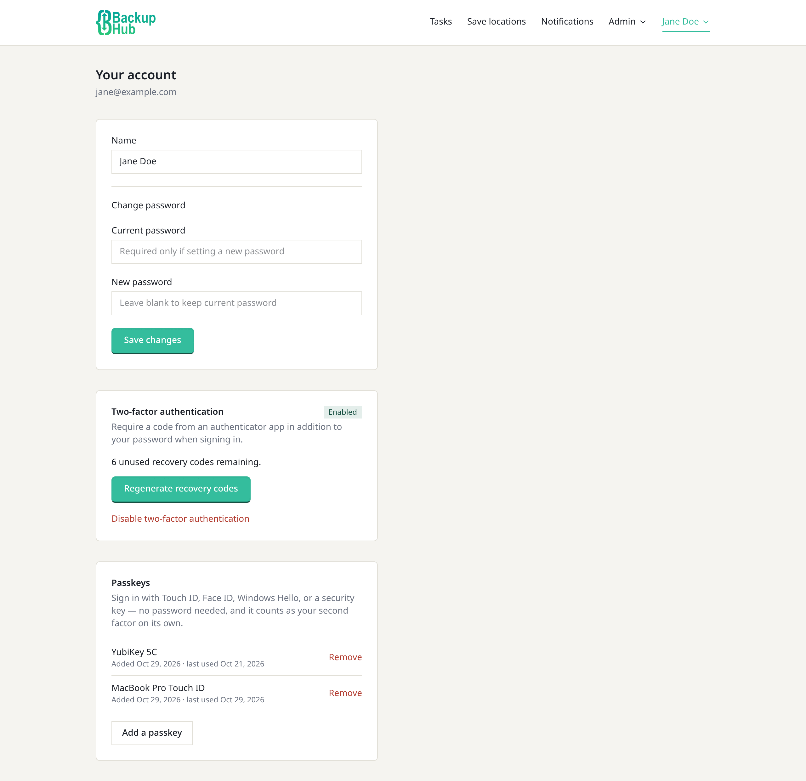
    </td>
    <td width="50%" valign="top">
      <b>Users (admin)</b> — admins add and manage users; tasks stay private to their owner.<br /><br />
      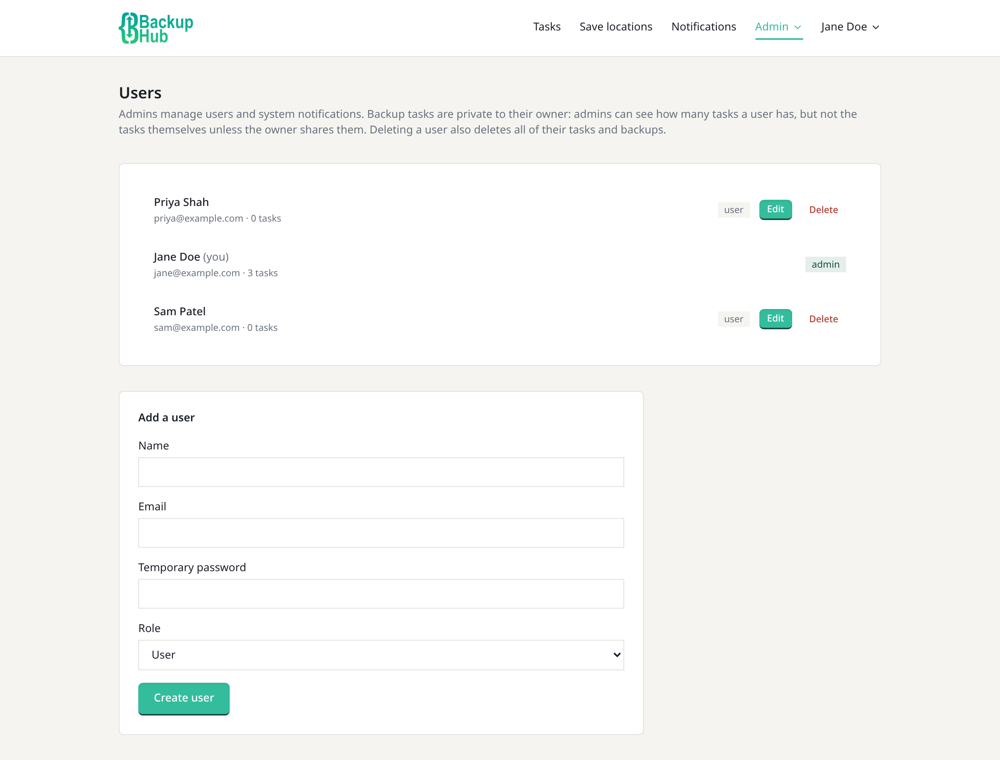
    </td>
  </tr>
</table>

<table>
  <tr>
    <td width="50%" valign="top">
      <b>API keys</b> — scoped keys for the REST API, optionally pinned to one task.<br /><br />
      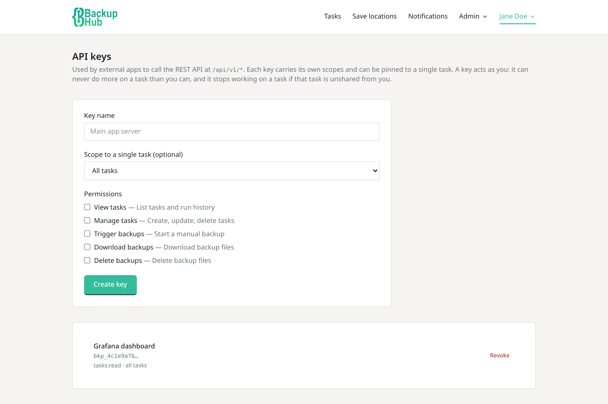
    </td>
    <td width="50%" valign="top">
      <b>Sign in</b> — with a password (plus two-factor) or a passkey.<br /><br />
      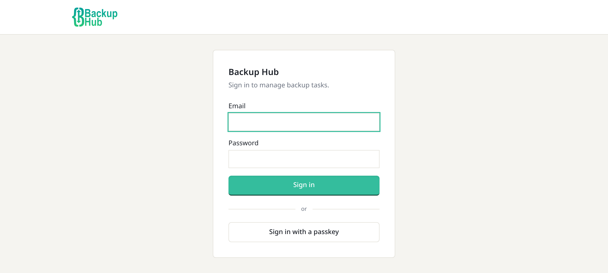
    </td>
  </tr>
</table>

</details>

<sub>Screenshots show demo data.</sub>

## Repository layout

This repo is split into these top-level folders:

| Folder | What's in it |
|---|---|
| [`code/`](code/) | The actual application — a Next.js app. This is where you'll find the source, the full project documentation ([`code/README.md`](code/README.md)), and the license. |
| [`docs/`](docs/) | Screenshots used in this README. |
| [`docker/`](docker/) | Everything needed to run Backup Hub in Docker: the `Dockerfile`, a ready-to-use `docker-compose.yml` (Backup Hub + a MySQL container), the container's `entrypoint.sh`, and a multi-arch `build.sh` build script. |

If you're just here to run it, you don't need to open `code/` at all — start with `docker/` below.

## Quick start (Docker Compose)

The `docker/` folder ships a `docker-compose.yml` that runs Backup Hub alongside its own MySQL database (the one Backup Hub uses to store its users, tasks, and run history — separate from whatever databases *you* point it at to back up).

```bash
cd docker
cp example.env-file .env
```

Edit `.env` and set real values — at minimum, generate a real secret for `BACKUP_MASTER_KEY` (used to encrypt stored DB credentials and backup passwords at rest) and set strong MySQL passwords:

```bash
openssl rand -hex 32   # → BACKUP_MASTER_KEY
```

Then bring it up:

```bash
docker compose up -d
```

Visit `http://localhost:3000` — there are no users yet, so you'll land on `/setup` to create the first admin account.

### What's actually in `docker/docker-compose.yml`

For reference, here's the shape of it — Backup Hub itself, plus a MySQL container it depends on and waits for to be healthy before starting:

```yaml
services:
  backup-hub:
    image: myfin/backup-hub:latest
    container_name: backup-hub
    restart: always
    ports:
      - "3000:3000"
    environment:
      APP_DATABASE_URL: "mysql://${BH_DATABASE_USER}:${BH_DATABASE_PASSWORD}@${BH_DATABASE_HOST}:3306/${BH_DATABASE_NAME}"

      # Read by entrypoint.sh
      BH_DATABASE_HOST: "${BH_DATABASE_HOST}"
      BH_DATABASE_NAME: "${BH_DATABASE_NAME}"
      BH_DATABASE_USER: "${BH_DATABASE_USER}"
      BH_DATABASE_PASSWORD: "${BH_DATABASE_PASSWORD}"
      BH_DATABASE_ROOT_PASSWORD: "${BH_DATABASE_ROOT_PASSWORD}"

      BACKUP_MASTER_KEY: "${BH_BACKUP_MASTER_KEY}"
      BACKUP_DIR: "/var/backups/backup-hub"

      SMTP_HOST: "${BH_SMTP_HOST}"
      SMTP_PORT: "${BH_SMTP_PORT}"
      SMTP_SECURE: "${BH_SMTP_SECURE}"
      SMTP_USER: "${BH_SMTP_USER}"
      SMTP_PASS: "${BH_SMTP_PASS}"
      SMTP_FROM: "${BH_SMTP_FROM}"

      WEBAUTHN_RP_NAME: "${BH_WEBAUTHN_RP_NAME}"
      WEBAUTHN_RP_ID: "${BH_WEBAUTHN_RP_ID}"
      WEBAUTHN_ORIGIN: "${BH_WEBAUTHN_ORIGIN}"

      # Optional: servers for test restores (see example.env-file).
      VERIFY_MYSQL_URL: "${BH_VERIFY_MYSQL_URL:-}"
      VERIFY_POSTGRES_URL: "${BH_VERIFY_POSTGRES_URL:-}"

    volumes:
      - ./data/backups:/var/backups/backup-hub

    depends_on:
      backup-hub-db:
        condition: service_healthy

    networks:
      - backup-hub-frontend
      - backup-hub-backend

  backup-hub-db:
    image: mysql:latest
    container_name: backup-hub-db
    restart: always
    environment:
      MYSQL_DATABASE: "${BH_DATABASE_NAME}"
      MYSQL_USER: "${BH_DATABASE_USER}"
      MYSQL_PASSWORD: "${BH_DATABASE_PASSWORD}"
      MYSQL_ROOT_PASSWORD: "${BH_DATABASE_ROOT_PASSWORD}"

    volumes:
      - ./data/mysql:/var/lib/mysql

    healthcheck:
      test: ["CMD", "mysqladmin", "ping", "-h", "localhost", "-u", "root", "-p${BH_DATABASE_ROOT_PASSWORD}"]
      interval: 5s
      timeout: 5s
      retries: 10

    networks:
      - backup-hub-backend

networks:
  backup-hub-frontend:
    driver: bridge

  backup-hub-backend:
    driver: bridge
    internal: true
```

A few things worth knowing about this setup:

- **`./data/backups` and `./data/mysql`** are bind-mounted into `docker/data/` on the host, so both your backup files and Backup Hub's own database survive a `docker compose down`/`up`.
- **`entrypoint.sh`** (baked into the image) waits for MySQL to report healthy, creates the database/user if they don't exist yet, runs any pending migrations, then starts the app — so `docker compose up -d` alone is enough on a first run.
- The image already includes `mysqldump`/`mariadb-dump` and `pg_dump`/`pg_isready`, so it can back up either engine out of the box — you don't need to install anything extra to back up a Postgres database even though the bundled `db` service here is MySQL (that MySQL container is only for Backup Hub's own data).

### Building the image yourself

If you'd rather build locally instead of pulling `myfin/backup-hub:latest`, use the provided script from the repo root:

```bash
./docker/build.sh 1.0.0 myfin/backup-hub          # builds locally
./docker/build.sh 1.0.0 myfin/backup-hub --push    # builds & pushes (multi-arch)
```

It builds from `docker/dockerfile` with the repo root as build context, so run it from the repo root as shown above.

### Running without Docker

You can also run Backup Hub directly with Node — see [`code/README.md`](code/README.md#getting-started) for that path (you'll need `mysqldump` and/or `pg_dump` installed locally in that case, since there's no image doing it for you).

## Full documentation

Everything else — the full feature list, user roles and permissions, the REST API reference, two-factor auth and passkeys, how encrypted backups work, and a troubleshooting guide for common `mysqldump`/`pg_dump` version-mismatch errors — lives in [`code/README.md`](code/README.md).

## License

MIT — see [`code/LICENSE`](code/LICENSE).